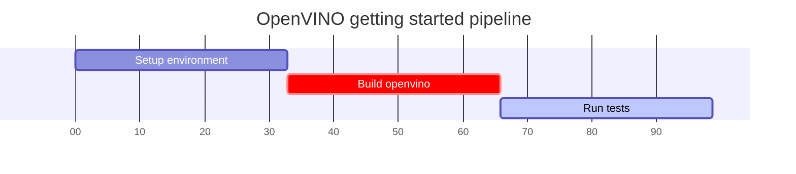

# 如何构建 OpenVINO

以下文章介绍构建 OpenVINO 的基本信息。

* [Windows](build_windows.md)
* [Linux](build_linux.md)
* [Mac（Intel CPU）](build_mac_intel_cpu.md)
* [Mac（ARM）](build_mac_arm.md)
* [Android](build_android.md)
* [Raspbian Stretch](./build_raspbian.md)
* [Web Assembly](./build_webassembly.md)
* [Docker 镜像](https://github.com/openvinotoolkit/docker_ci)
* [Linux RISC-V](./build_riscv64.md)

> **注意**：如何构建静态 OpenVINO 的详情，请参阅[构建静态 OpenVINO 库](static_libraries.md)

## 另请参阅

 * [OpenVINO README](../../README.md)
 * [OpenVINO 开发者文档](index.md)
 * [OpenVINO 入门](./get_started.md)