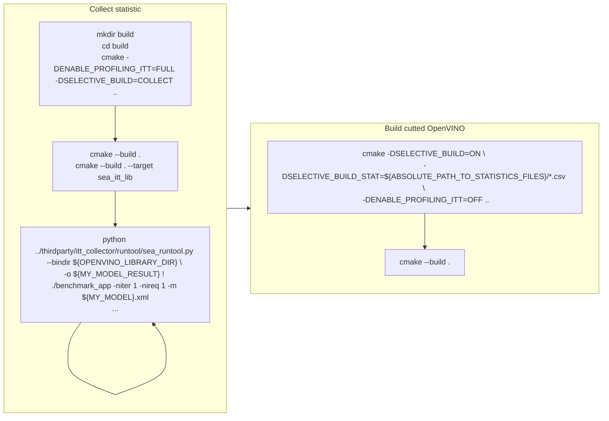

# OpenVINO 条件编译

## 目录

- [简介](#简介)
- [针对不同模型构建](#针对不同模型构建)
- [针对不同 ISA 的设备构建](#针对不同-isa-的设备构建)
- [限制](#限制)

## 简介

条件编译可显著减小 OpenVINO™ 二进制文件体积，剔除特定模型推理不需要的组件。这些组件包括：
* OpenVINO Runtime 和插件中的层与图变换，
* OpenVINO Runtime 操作，
* CPU 插件中的 JIT 内核，
* 特定模型推理未使用的任意代码。

但条件编译有显著缺点：生成的 OpenVINO 运行时只能正确推理编译时所用的模型和设备。若仅用一个模型收集统计信息，则只有该模型能保证在生成的 OpenVINO 运行时上正常工作。

条件编译有两个构建阶段：`SELECTIVE_BUILD=COLLECT` 和 `SELECTIVE_BUILD=ON`。

`SELECTIVE_BUILD=COLLECT` 为带注解的代码区域启用分析模式，可用 `itt` 收集统计数据。此阶段完成后，运行 OpenVINO 示例（如 benchmark_app）生成实际统计数据，再运行 `itt_collector tool` 将数据导出为 csv 文件。此阶段可在 OpenVINO 构建时通过选项 `-DSELECTIVE_BUILD=COLLECT -DENABLE_PROFILING_ITT=FULL` 启用。

`SELECTIVE_BUILD=ON` 使用 `itt_collector tool` 生成的 `csv 文件`，从编译产物中剔除所有未激活的带注解代码区域。实现方式是通过从 `csv 文件` 生成的头文件。此阶段需以选项 `-DSELECTIVE_BUILD=ON -DENABLE_PROFILING_ITT=OFF -DSELECTIVE_BUILD_STAT=<cc_data.csv>` 构建 OpenVINO。注意：`-DENABLE_PROFILING_ITT=OFF` 并非必须；若希望在最终应用中保留 ITT 计数器，可设为 FULL：`-DENABLE_PROFILING_ITT=FULL`。

> **注意**：若未启用上述选项，条件编译将关闭并保持默认行为，启用所有 OpenVINO 功能。可忽略 `SELECTIVE_BUILD` 或设置 `-DSELECTIVE_BUILD=OFF`。

### 环境准备

要使用条件编译，请安装以下工具：
* [Python](https://www.python.org)

## 针对不同模型构建

条件编译有两个阶段：
* 收集代码使用信息
* 构建不含未使用组件的最终二进制文件

应用条件编译，请按以下步骤操作：

1. 执行代码使用分析：
    1. 使用以下选项运行 CMake 工具：`-DENABLE_PROFILING_ITT=FULL -DSELECTIVE_BUILD=COLLECT`。
    2. 选择特定应用或目标设备要使用的若干模型。
    3. 使用 `sea_itt_lib` 目标构建 ITT 收集器。
    4. 在 ITT 收集器下运行目标应用，对每个模型进行代码使用分析。统计数据以 `.csv` 格式生成。
`python thirdparty/itt_collector/runtool/sea_runtool.py --bindir ${OPENVINO_LIBRARY_DIR} -o ${MY_MODEL_RESULT} ! ./benchmark_app -niter 1 -nireq 1 -m ${MY_MODEL}.xml`
2. 构建最终二进制文件：
    1. 使用以下选项运行 CMake 工具：`-DSELECTIVE_BUILD=ON -DSELECTIVE_BUILD_STAT=${ABSOLUTE_PATH_TO_STATISTICS_FILES}/*.csv -DENABLE_PROFILING_ITT=OFF`
    2. `cmake --build <cmake_build_directory>`

强烈建议为 benchmark_app 使用 `-niter 1 -nireq 1` 标志，否则跟踪文件会非常大。
若使用 benchmark_app 以外的应用，请记得限制推理请求数和迭代次数。

## 针对不同 ISA 的设备构建

针对不同 ISA 的设备构建与针对不同模型构建非常相似（参见上一章）。
区别仅在于代码使用分析步骤。分析步骤应在目标设备上执行，所有统计 CSV 文件应复制到构建机器。这些文件将用于最终构建。

## 限制

* 目前条件编译构建不支持 Ninja 构建系统。
* 目前条件编译仅支持 OpenVINO IR 模型。要启用条件编译，需先将其他框架（PyTorch、TensorFlow、ONNX 等）的模型转换为 OpenVINO IR 模型。

## 另请参阅
 * [OpenVINO™ README](../../README.md)
 * [开发者文档](../../docs/dev/index.md)
 * [如何为新组件启用条件编译](../../src/common/conditional_compilation/docs/develop_cc_for_new_component.md)