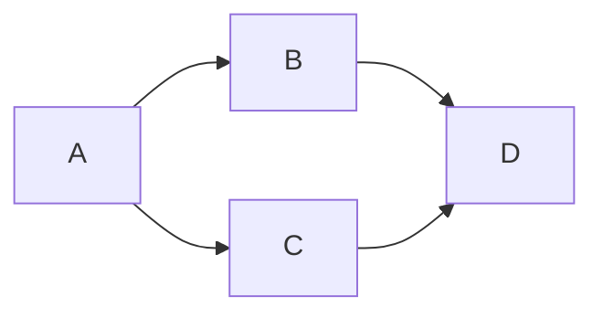

# 编写开发者文档

开发者文档概述组件开发，帮助工程师理解底层技术。
本指南包含编写开发者文档的要求。


## 组件结构

OpenVINO 组件结构在[开发者文档的专门章节](./index.md#openvino-component-structure)中有完整定义。
本指南重点介绍用于开发者文档的部分。结构如下：

```
openvino_component/
    docs/               // 包含详细的组件文档
    README.md           // 开发者文档的入口
```

## ***README.md*** 内容

README.md 是组件文档的入口。以下是编写优秀 README.md 的最佳实践：

- 只包含必要信息。避免文档因过多细节而臃肿。
- 确保文档结构清晰、易于导航、便于快速浏览。
- 提供指向其他文档和资源的链接。

README.md 文件可使用以下模板：
```md
# 组件名称

组件的简要信息。
 * 职责
 * 支持的功能
 * 代码风格

## 关键联系人

本节提供开发人员分组信息，他们可在有疑问时提供帮助，并负责审查和合并 PR。

## 组件

本节包含所包含组件的基本信息：API、源码、测试等。
详细信息可放在 `docs/` 文件夹中。本节可包含指向这些页面的链接。

## 架构

可选章节，介绍组件架构的主要思路。
可包含指向更多信息页面的引用。

## 教程

本节包含组件教程列表。
示例：
 * [如何支持新算子](./docs/operation_support.md)
 * [如何实现新功能](./docs/new_feature.md)
 * [如何调试组件](./docs/debug_capabilities.md)
 * ...

## 另请参阅

本节包含相关页面列表。
示例：
 * [OpenVINO™ README](../../README.md)
 * [开发者文档](../../docs/dev/index.md)
 * ...
```

## ***docs/*** 文件夹内容

docs 文件夹应包含详细描述组件功能的页面，以及开发者文档的媒体内容。确保此文件夹中的页面提供与主题直接相关的信息。其他主题的信息最好放在单独文件中并引用。

## 媒体内容
开发者文档可包含图片、图表和示例，用于说明所描述的功能，使其更易理解。
建议使用 `mermaid` 框架绘制图表。阅读 [Github 文档](https://docs.github.com/en/get-started/writing-on-github/working-with-advanced-formatting/creating-diagrams)了解更多信息。该框架可创建图表并粘贴到文档中。例如，以下代码：

````md

````

生成如下图表：


## 另请参阅
 * [OpenVINO™ README](../../README.md)
 * [开发者文档](./index.md)