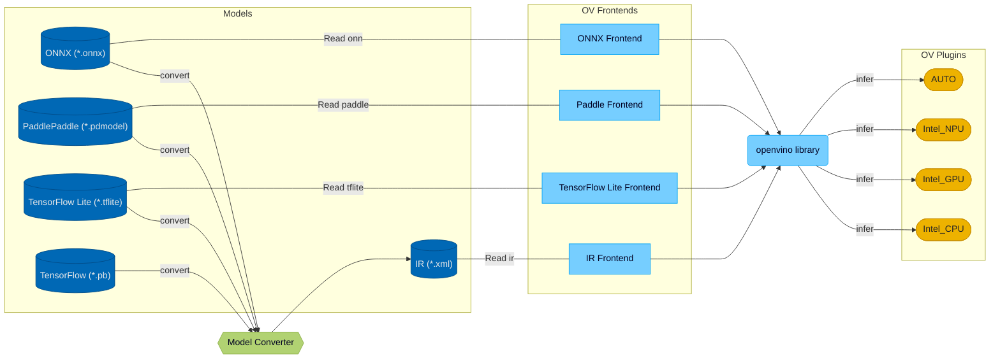

# OpenVINO™ 开发者文档

欢迎阅读 OpenVINO™ 开发者文档。本文档帮助深入理解 OpenVINO 架构，并详细介绍其内部使用的概念与设计思路。

OpenVINO™ 支持从不同框架加载模型，并在不同加速器上运行。



## [快速入门](./get_started.md)

 * [构建 OpenVINO](./build.md)
 * 操作指南：
     * [添加新算子](../../src/core/docs/operation_enabling_flow.md)
     * [添加新的条件编译](../../src/common/conditional_compilation/docs/develop_cc_for_new_component.md)
     * [添加新变换](#todo)
     * [获取代码覆盖率报告](./test_coverage.md)
     * [添加组件开发者文档](./dev_doc_guide.md)
     * [使用 OpenVINO 公共 CI](./public_ci.md)
 * [OpenVINO 贡献指南](../../CONTRIBUTING.md)
 * [OpenVINO 调试能力](./debug_capabilities.md)

## OpenVINO 仓库结构

仓库的组织方式是：每个组件包含其全部依赖（例如第三方库、测试、文档等）。

OpenVINO 仓库包含以下组件。点击组件名称获取更多信息：
<pre>
 <code>
 <a href="../../README.md">openvino/</a>                  // OpenVINO 仓库
    .github/                // GitHub Actions 与 PR 模板
    cmake/                  // 全局 CMake 脚本
    docs/                   // OpenVINO 文档
    licensing/              // 许可证
    samples/                // OpenVINO 示例
    scripts/                // 辅助脚本
    <a href="../../src/README.md">src/</a>                    // OpenVINO 核心组件目录
    tests/                  // 验证完整流水线的基础设施测试
    thirdparty/             // 公共第三方依赖
    tools/                  // OpenVINO 工具
 </code>
</pre>


### OpenVINO 组件

OpenVINO 组件包括：

  * [OpenVINO™ Runtime](https://docs.openvino.ai/2026/openvino-workflow/running-inference.html) - 一组 C++ 库，提供 C 和 Python 绑定，通过统一 API 在任意平台上交付推理方案。
    * [core](../../src/core) - 提供模型表示与修改的基础 API。
    * [inference](../../src/inference) - 提供在设备上推理模型的 API。
    * [transformations](../../src/common/transformations) - 包含 OpenVINO 插件中使用的通用变换集。
    * [低精度变换](../../src/common/low_precision_transformations) - 包含低精度模型中使用的变换集
    * [bindings](../../src/bindings) - 包含 OpenVINO 团队维护的全部 OpenVINO 绑定。
        * [c](../../src/bindings/c) - OpenVINO™ Runtime 的 C API
        * [python](../../src/bindings/python) - OpenVINO™ Runtime 的 Python API
* [插件](../../src/plugins) - 包含 OpenVINO 团队以开源方式维护的 OpenVINO 插件。更多信息请参阅[支持的设备列表](https://docs.openvino.ai/2026/documentation/compatibility-and-support/supported-devices.html)。
* [前端](../../src/frontends) - 包含可用的 OpenVINO 前端，用于读取原生框架格式的模型。
* [OpenVINO 模型转换器 (OVC)](https://docs.openvino.ai/2026/openvino-workflow/model-preparation.html) - 跨平台命令行工具，用于衔接训练与部署环境，并针对终端目标设备优化深度学习模型。
* [示例](https://github.com/openvinotoolkit/openvino/tree/master/samples) - C、C++ 和 Python 语言编写的应用，展示 OpenVINO 的基本用例。

#### OpenVINO 组件结构

OpenVINO 组件包含其全部依赖（例如第三方库、测试、文档等）。下面给出一个带注释和可选文件夹标记的组件结构示例。

```
ov_component/           // 组件目录
    cmake/              // （可选）仅与本组件相关的 CMake 脚本
    dev_api/            // （可选）开发者 API，用于组件向内部开发者提供 API
    docs/               // （可选）详细的组件文档
    include/            // （可选）组件公共 API
    src/                // 组件源码
    tests/              // 组件测试
    thirdparty/         // （可选）第三方依赖
    CMakeLists.txt      // 主 CMake 脚本
    README.md           // （可选）开发者文档入口
```


## 特性

 * [条件编译](./conditional_compilation.md)

## 另请参阅

 * [OpenVINO 开发者文档](./index.md)
 * [OpenVINO README](../../README.md)