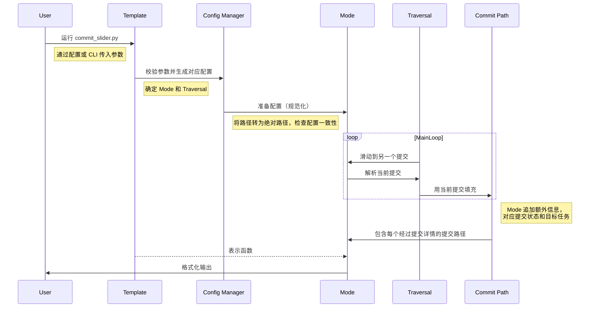
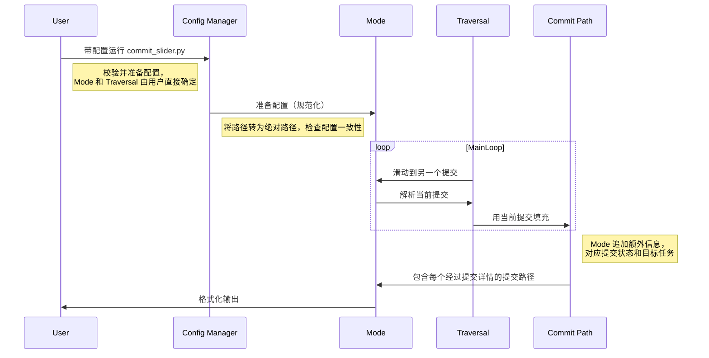

## 使用模板的 CS 工作流

通过 CS 解决问题有两种基本方式：纯配置和 `Template`。前者使用完整的底层功能。`Template` 可以创建自定义 API 和输出表示。

CS 通过配置使用 `Template`：
```
{
    'template' : {
        'name' : 'some_template',
        'parameter_1' : '...',
        ...
        'parameter_N' : '...'
    }
}
```
或通过 CLI：

`python3 commit_slider -t some_template <template parameters>`



## 不使用模板的 CS 工作流（纯配置）
